# SCAPMS – UML Class Diagram

**Student:** Linda Obodo  **Course:** COS202 Computer Programming II – Lab Assessment

Legend: `<|--` inheritance · `<|..` interface implementation · `*--` composition (owns) · `o--` aggregation (non-owning) · `-->` association / uses.
Classes marked `<<abstract>>` have pure virtual functions; methods marked `*` are pure virtual (`= 0`) and are overridden polymorphically. `$` marks static members. `PatientRecord_ptr` stands for `const PatientRecord*` (a non-owning pointer).

Each subclass overrides the behaviour differently:

| Subclass | `priority()` | `scheduleAppointment()` rule |
|---|---|---|
| GeneralPatient | 1 | Standard booking, tagged "Normal" |
| EmergencyPatient | 10 + severity (11–15) | Tagged "URGENT"; joins the emergency queue that is called first |
| FollowUpPatient | 5 | Refuses dates before the previous visit; tagged "Follow-up" |

```mermaid
classDiagram
    direction TB

    namespace model {
        class Appointable {
            <<interface>>
            +scheduleAppointment(Appointment&)*
            +cancelAppointment(Appointment&)* bool
            +appointmentIds()* vector~int~
        }
        class PatientRecord {
            <<abstract>>
            -string id_
            -string name_
            -int age_
            -string contact_
            -vector~int~ appointmentIds_
            +category()* string
            +priority()* int
            +consultationPlan()* string
            +details()* string
            +extraValues()* vector~string~
            +setExtraValues(values)*
            +clone()* unique_ptr~PatientRecord~
            +describe() string
            +cancelAppointment(Appointment&) bool
            +validateAge(int)$ int
        }
        class GeneralPatient {
            -string complaint_
            +priority() int
            +scheduleAppointment(Appointment&)
        }
        class EmergencyPatient {
            -int severity_
            -string triageNote_
            +priority() int
            +scheduleAppointment(Appointment&)
        }
        class FollowUpPatient {
            -string previousVisitDate_
            -string doctor_
            +priority() int
            +scheduleAppointment(Appointment&)
        }
        class Appointment {
            -int id_
            -string patientId_
            -string date_
            -string time_
            -string reason_
            -AppointmentStatus status_
            -string tag_
            +isValidDate(string)$ bool
            +isValidTime(string)$ bool
        }
        class AppointmentStatus {
            <<enumeration>>
            Scheduled
            Completed
            Cancelled
        }
        class ClinicDatabase {
            -vector~unique_ptr~PatientRecord~~ patients_
            -vector~Appointment~ appointments_
            +addPatient(PatientPtr)
            +removePatient(id) PatientPtr
            +replacePatient(PatientPtr) PatientPtr
            +addAppointment(Appointment)
            +rebuildLinks()
        }
        class PatientFactory {
            +create(category, id, name, age, contact, extras)$ unique_ptr~PatientRecord~
            +extraFields(category)$ vector~ExtraField~
        }
    }

    namespace controller {
        class ClinicManager {
            -ClinicDatabase database_
            -UndoManager undo_
            -RecentPatientCache cache_
            -IDGenerator ids_
            -queue~QueueEntry~ urgentQueue_
            -queue~QueueEntry~ normalQueue_
            +registerPatient(PatientInput) string
            +editPatient(id, PatientInput)
            +deletePatient(id)
            +processPatient(const PatientRecord&) string
            +search(field, keyword, algorithm) SearchResult
            +sortPatients(field, algorithm) SortReport
            +addToQueue(id)
            +callNext() QueueEntry
            +undoLast() string
            +save(path)
            +load(path)
        }
        class AppointmentController {
            +schedule(patientId, date, time, reason)
            +cancel(id)
            +complete(id)
        }
        class SearchEngine {
            +linearSearchById()$
            +binarySearchById()$
            +linearSearchByName()$
            +binarySearchByName()$
            +recursiveSearch()$
        }
        class SortEngine {
            +sort(patients, field, algorithm)$ SortReport
            +recommend(n, outOfOrder)$ SortAlgorithm
        }
        class UndoManager {
            -stack~unique_ptr~UndoCommand~~ history_
            +push(command)
            +undoLast(db) string
        }
        class UndoCommand {
            <<abstract>>
            +undo(ClinicDatabase&)*
            +description()* string
        }
        class DeletePatientCommand
        class EditPatientCommand
        class CancelAppointmentCommand
        class RecentPatientCache {
            -PatientRecord_ptr slots_[10]
            -int uses_[10]
            +find(id) PatientRecord_ptr
            +put(patient)
            +invalidate(id)
        }
        class ReportGenerator {
            +mostFrequentlyAttended() string
            +pendingAppointments() string
            +categoryDistribution() string
            +dailySummary(date) string
        }
    }

    namespace utils {
        class IDGenerator
        class FileHandler {
            +save(db, path)$
            +load(path)$ ClinicDatabase
        }
        class ClinicException {
            <<exception>>
        }
        class InvalidPatientException
        class InvalidAgeException
        class DuplicateIdException
        class InvalidAppointmentException
        class FileException
        class InvalidSearchException
        class NotFoundException
    }

    namespace gui {
        class MainWindow {
            -ClinicManager manager_
            -QTimer* timer_
            +onSave()
            +onOpen()
            +onUndo()
            +onTick()
        }
        class BasePanel {
            <<abstract>>
            +refresh()*
            +dataChanged() signal
            +statusMessage(QString) signal
        }
        class AdminPanel
        class PatientPanel
        class AppointmentPanel
        class QueuePanel
        class SearchPanel
        class ReportPanel
    }

    %% ---- inheritance / interface ----
    Appointable <|.. PatientRecord
    PatientRecord <|-- GeneralPatient
    PatientRecord <|-- EmergencyPatient
    PatientRecord <|-- FollowUpPatient
    UndoCommand <|-- DeletePatientCommand
    UndoCommand <|-- EditPatientCommand
    UndoCommand <|-- CancelAppointmentCommand
    ClinicException <|-- InvalidPatientException
    InvalidPatientException <|-- InvalidAgeException
    ClinicException <|-- DuplicateIdException
    ClinicException <|-- InvalidAppointmentException
    ClinicException <|-- FileException
    ClinicException <|-- InvalidSearchException
    ClinicException <|-- NotFoundException
    BasePanel <|-- AdminPanel
    BasePanel <|-- PatientPanel
    BasePanel <|-- AppointmentPanel
    BasePanel <|-- QueuePanel
    BasePanel <|-- SearchPanel
    BasePanel <|-- ReportPanel

    %% ---- composition (owns) ----
    ClinicDatabase "1" *-- "0..*" PatientRecord : owns
    ClinicDatabase "1" *-- "0..*" Appointment : owns
    ClinicManager "1" *-- "1" ClinicDatabase
    ClinicManager "1" *-- "1" UndoManager
    ClinicManager "1" *-- "1" RecentPatientCache
    ClinicManager "1" *-- "1" IDGenerator
    ClinicManager "1" *-- "1" AppointmentController
    UndoManager "1" *-- "0..*" UndoCommand
    MainWindow "1" *-- "1" ClinicManager
    MainWindow "1" *-- "6" BasePanel

    %% ---- association / aggregation ----
    PatientRecord "1" --> "1..*" Appointment : has appointments
    Appointment --> AppointmentStatus
    RecentPatientCache o-- "0..10" PatientRecord : non-owning pointers
    ClinicManager --> SearchEngine : uses
    ClinicManager --> SortEngine : uses
    ClinicManager --> ReportGenerator : creates
    ClinicManager --> FileHandler : uses
    ClinicManager --> PatientFactory : uses
    PatientFactory ..> GeneralPatient : creates
    PatientFactory ..> EmergencyPatient : creates
    PatientFactory ..> FollowUpPatient : creates
    BasePanel --> ClinicManager : calls
```

## How the diagram shows the required concepts

| Concept | Where in the diagram |
|---|---|
| **Inheritance** | `GeneralPatient`, `EmergencyPatient`, `FollowUpPatient` → `PatientRecord`; the `UndoCommand`, `ClinicException` and `BasePanel` hierarchies |
| **Abstract classes** | `PatientRecord` (7 pure virtual functions), `UndoCommand`, `BasePanel`; `Appointable` is a pure interface |
| **Polymorphism** | `ClinicManager::processPatient(const PatientRecord&)` and `AppointmentController::schedule()` call `priority()`, `consultationPlan()`, `scheduleAppointment()` through base-class references; the right subclass version runs at run time |
| **Composition** | `ClinicDatabase` *owns* its patients (`unique_ptr`) and appointments; `ClinicManager` owns the database, undo stack, cache and ID generator |
| **Association / aggregation** | Patient ↔ Appointment (one patient, one or more appointments, linked by ID); `RecentPatientCache` holds non-owning pointers to patients |
